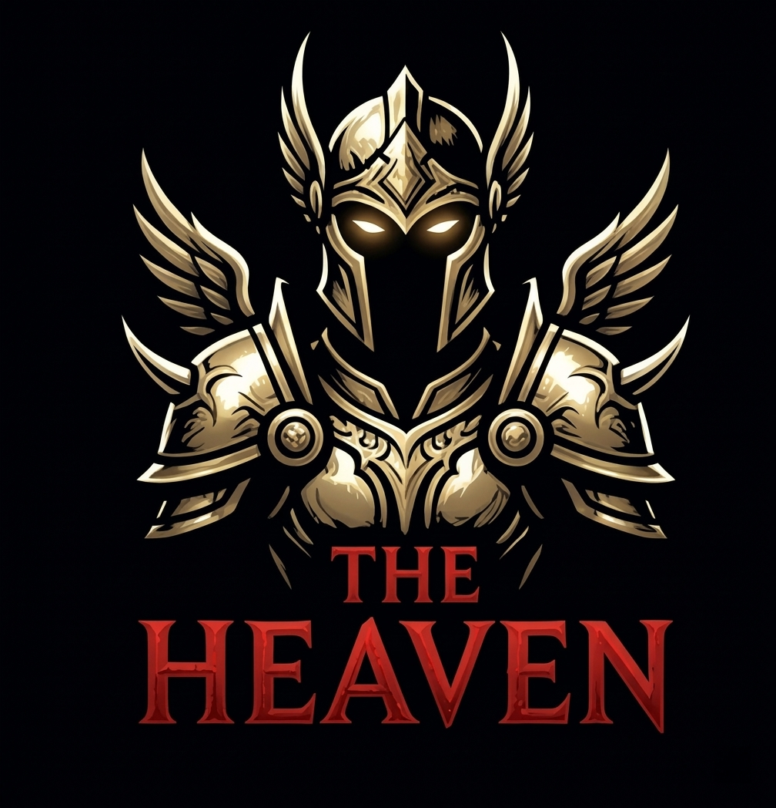

  

  A free overhaul of Diablo 1, with less grind and more fun!

  ### [⬇️ Download Latest Release](https://github.com/roboserg/diablo-1-the-heaven/releases)

  

## About

The Heaven is a free overhaul of Diablo 1, built on The Hell 4 **v0.774** (October 2026), a fan-made overhaul of the same game. It keeps the depth and challenge and cuts the grind.

### What's in the game, from The Hell 4:
* 24 dungeon floors
* 40 quest levels (35 in multiplayer)
* 6 classes with 31 subclasses
* 52 spells
* 2,000+ base item types
* 2,500+ unique and set items

### What The Heaven changes:

**Shared stash:** talk to Gillian in town to open a stash that all your characters share, single-player and multiplayer. Griswold keeps each character's own stash. Neither is available in Ironman, Speedrun or Nightmare. An item that would change for the character opening the shared stash is shown in red and stays in it.

**No penalties on unique and set items:** harmful stats are gone, such as lower stats, resistances, armour or life, and more damage from enemies. Trade-offs, like moving life to mana, stay, and so does -light radius, which archers and mages use to pull fewer monsters.

**Stat cap doubled:** outside Classic mode, the cap on your stats at each character level is twice as high. Elixirs and shrines raise stats up to it, and they stay there.

### Balance Adjustment Examples:
* **Game Speed Control**: Time speed button (1.0x → 1.25x → 1.5x) now available in all single-player game modes
* **Independent Rare Item Drops**: Rare items have their own drop roll, separate from unique items, and bosses get three times the chance. The Hell 4 leaves rare items out of its main modes
* **Rare Item Affixes Buffed**: Many rare item affix values are now higher, by about 25% to 50%
* **Acceleration Game Changer**: Experience multiplier increased from 2x to 5x (single player)
* **Swift Learner Perk**: XP gain per level increased from +5% to +20%
* **Black Mushroom Quest**: Spectral Elixir now grants +5 to all stats in non-Classic modes
* **Psion Aura**: Damage output ~50% higher due to improved scaling formula (reverted to The Hell 2 levels)
* **Grim Deal Trait**: Fixed undocumented spell damage penalty that was silently reducing all spell damage
* **Infernal Bargain Synergy**: Re-enabled for all classes. Trades life & mana regeneration and all stats for extra perk points

For complete release notes and version history, see [CHANGELOG](docs/CHANGELOG.md). For a full list of quests and objectives, see [QUESTS](docs/QUESTS.md).

> The Heaven needs `TH4data.mor` from The Hell 4 v0.774; an older one won't work. Save files from The Hell 4 **aren't supported**. For The Hell 4 documentation, see [TH4_Changelog.txt](docs/legacy/TH4_Changelog.txt) and [TH4_Readme.txt](docs/legacy/TH4_Readme.txt).

## Installation

### Case 1: Fresh Installation (TH4 not installed)

1. **Set up your mod directory** — You only need `DIABDAT.MPQ` from Diablo 1
   - **Option A:** Use your existing Diablo 1 installation directory
   - **Option B:** Create a new "Diablo The Heaven" folder and copy `DIABDAT.MPQ` there

2. **Get The Hell 4 v0.774** and copy its `TH4data.mor` to your chosen directory. Use your own copy of v0.774, or download the [backup copy](https://drive.google.com/file/d/1p50lTU8JDtfFM8lgLKiXp9vUwr3V4ROT/view) (`TH4_v0.774.7z`, extract it with [7-Zip](https://www.7-zip.org/)). The Heaven is built on v0.774, so `TH4data.mor` from an older TH4 won't work

3. **Download The Heaven mod** from [GitHub Releases](https://github.com/roboserg/diablo-1-the-heaven/releases) and extract all files to the same directory

4. **Run `TheHeaven.exe`** and enjoy!

### Case 2: Existing TH4 v0.774 Installation

> **Important:** Install The Heaven in its own folder, not in your TH4 folder. Both games use the same save file names and the same `config.ini`, so in the TH4 folder The Heaven would open and overwrite your TH4 saves and replace TH4's settings.
>
> If your TH4 is older than v0.774, follow Case 1 instead.

1. **Create a new folder**, such as "Diablo The Heaven", and copy `DIABDAT.MPQ` and `TH4data.mor` into it from your TH4 folder. If you have The Hell 4's music files (`THmusic*.mor`) or a language pack (`TH4loc_*.mor`), copy those too

2. **Download The Heaven mod** from [GitHub Releases](https://github.com/roboserg/diablo-1-the-heaven/releases) and extract all files to the new folder

3. **Run `TheHeaven.exe`** and enjoy!

### Updating from The Heaven v0.2.0

1. **Get The Hell 4 v0.774** and copy its `TH4data.mor` to your game folder, as in Case 1. An older one won't work

2. **Extract The Heaven** to your game folder (overwrite when prompted) and **run `TheHeaven.exe`**

Your characters, Griswold's stash and the shared stash carry over, except for Classic characters: v0.3.0 doesn't list them, because The Hell 4 v0.774 renamed Classic save files. Their save files stay on disk, and the next update lists them again.

### Nightly Builds (Latest Features, May Have Bugs)

Want to try the newest features right away? Download the **`nightly`** build from [GitHub Releases](https://github.com/roboserg/diablo-1-the-heaven/releases). It's updated automatically with the latest changes, but may be unstable. For a safer experience, stick with regular versioned releases like `v0.3.0`.

## Planned changes

* Re-roll affixes on magic and rare items
* Item sharing in multiplayer

## Credits

Based on [the-hell-4-src](https://github.com/roboserg/the-hell-4-src), an upload of The Hell 4 v0.774 source files (dated October 13, 2026) that were publicly released by [The Hell team](https://www.patreon.com/thmod).